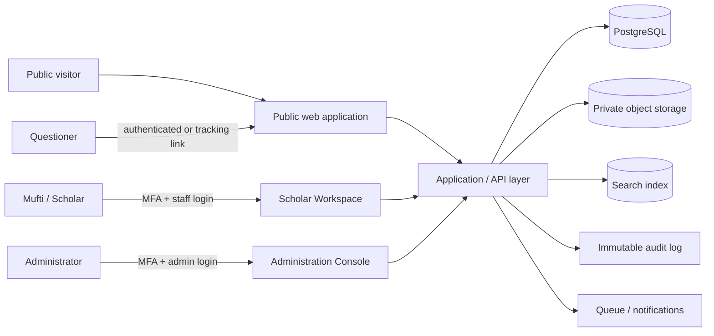
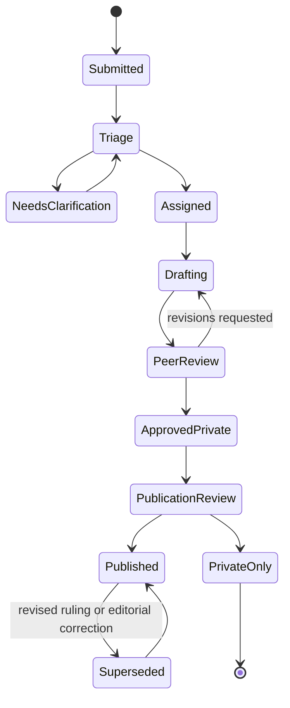
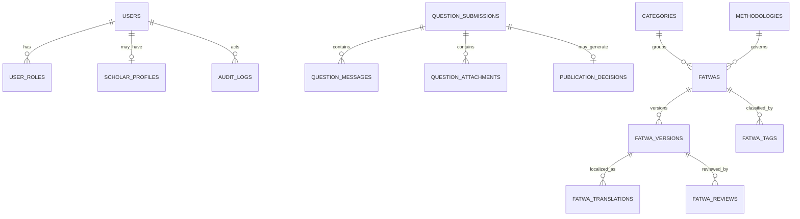

# Darul Ifta Digital Platform Blueprint

**Prepared for:** Darul Ifta Irshad-us-Saileen  
**Purpose:** Product, UX, technical architecture, security, and data-model plan for a multilingual Islamic legal-guidance platform.  
**Recommended implementation posture:** A public, fast editorial platform paired with a private, audit-ready scholarly workspace.

> A Darul Ifta platform should not behave like a generic support portal. It must make authoritative guidance easy to discover while preserving the confidentiality, scholarly review, and publication discipline required for sensitive religious questions.

## 1. Product Vision and Operating Principles

The platform should serve two distinct experiences from one governed content system. The public experience must be calm, immediately understandable, bilingual or trilingual, and extremely fast on mobile networks. The private experience must give authorized Muftis a reliable editorial workflow, clear ownership of each question, and an auditable publication record.

The primary measure of quality is not submission volume. It is whether a user can either find a reliable existing answer quickly or submit a sufficiently complete private question without uncertainty about confidentiality, methodology, or response expectations.

| Product principle | Design implication | Operational implication |
|---|---|---|
| **Scholarly authority** | Every public Fatwa displays the issuing body, methodology, status, and publication date. | No Fatwa can be publicly published without an accountable approver and immutable version history. |
| **Privacy by design** | Question forms collect only information required to answer safely; anonymity is visibly supported. | Private submissions and attachments are access-controlled, encrypted, logged, and excluded from public search. |
| **Clarity over volume** | Search promotes reviewed answers and offers a clear “submit a question” route when results do not fit. | Editorial review can merge duplicates, flag incomplete cases, and retain internal context without public disclosure. |
| **Language dignity** | English, Urdu, and Arabic receive equal structural support; Urdu and Arabic are genuinely RTL. | Translation status is per field and per Fatwa rather than treated as an afterthought. |
| **Mobile-first accessibility** | Short pages, large touch targets, readable Nastaliq/Arabic text, and low-bandwidth loading are default. | Target WCAG 2.2 AA, which defines testable accessibility requirements usable across devices.[1] |

## 2. Platform Architecture and User Roles

### 2.1 Trust Boundaries

The system should have three zones. The **public zone** contains only approved content and no personal-question data. The **authenticated user zone** contains a questioner’s own submissions, messages, and tracking state. The **staff zone** contains only the minimum question and moderation data required by each scholarly or administrative role.

Authorization must be enforced server-side for every request, with access denied unless a specific permission is granted. This is consistent with OWASP guidance on least privilege, deny-by-default behavior, and checking authorization on every request.[2]



### 2.2 Roles and Permission Matrix

Use **role-based access control with scoped attributes**. A person may be a Mufti and an editor, but permissions should be assigned explicitly rather than inferred from a job title. Assignment scope matters: a Mufti should normally see questions assigned to them or their team, not all historical private material.

| Role | Typical permissions | Explicit exclusions |
|---|---|---|
| **Visitor** | Browse published Fatwas and articles; search; view scholar bios, methodology, and public policies. | Cannot view private submissions, unapproved drafts, or personal data. |
| **Questioner** | Submit a question, choose anonymity, upload permitted evidence, view only their own case via account or secure tracking link, reply to clarification requests. | Cannot access another user’s case, reviewer notes, internal routing, or unpublished answers. |
| **Intake Editor** | Check completeness, remove obvious duplicate submissions, request clarification, route by topic/language/urgency. | Cannot change a Mufti’s ruling or publish a Fatwa. |
| **Mufti / Scholar** | Review assigned cases, draft answers, cite sources, assign methodology/category/tags, request peer review, propose publication. | Cannot administer roles, retention policy, or system-wide security settings. |
| **Senior Mufti / Reviewer** | Approve, return, co-sign, or reject scholarly drafts; approve public redaction and publication form. | Cannot silently alter an approved version without a new version record. |
| **Translator / Language Editor** | Create and review English, Urdu, or Arabic translations against an approved source answer. | Cannot alter source-language ruling or publish without workflow approval. |
| **Administrator** | Manage users, role assignments, categories, site settings, moderation queues, retention jobs, and audit access. | Should not access private question text by default; elevated access requires a reason and audit event. |
| **Auditor / Trustee** | Read audit trails, publication history, role changes, and aggregate reports. | No general access to private content or attachment downloads. |

### 2.3 Governance Model

The institution should designate a **presiding Mufti**, a **scholarly review group**, an **editorial custodian**, and a **data protection owner**. They should jointly maintain a written publication policy that defines what constitutes a Fatwa, what can be published as a general article, which cases remain private, the review threshold for sensitive topics, and the revision process when new facts require an update.

## 3. Information Architecture

The public site should favor direct paths, rather than making users decode institutional navigation. “Find an answer,” “Ask a question,” and “Understand our methodology” are the three essential starting points.

| Public navigation | Purpose | Key modules |
|---|---|---|
| **Home** | Establish trust and direct the next action. | Search, featured Fatwas, methodology summary, scholar supervision, quick categories, submission CTA. |
| **Fatwa Library** | Find published guidance. | Instant search, facets, category pages, methodology facet, chronology, popular/recent listings. |
| **Fatwa Detail** | Read a reviewed answer safely. | Question, answer, evidence/citations where suitable, methodology, scholar/reviewer, versions, related Fatwas, guidance disclaimer. |
| **Ask a Question** | Submit a confidential query. | Step-by-step form, privacy assurance, anonymity choice, tracking reference, expected response note. |
| **Articles & Research** | Publish broader scholarly content that is not case-specific. | Themes, authors, reading time, translations, related Fatwas. |
| **Scholars** | Demonstrate authority. | Qualifications, ijazat/lineage where approved for publication, areas of expertise, role in review. |
| **Methodology & Policies** | Explain governance and protect users. | Madhhab/methodology statement, scope limits, privacy policy, publication policy, corrections process. |
| **Contact & Support** | Handle non-Fatwa communications. | Institutional contact, office hours, technical support, emergency guidance boundaries. |

The private workspace should use a task-oriented sidebar: **Inbox, Assigned to Me, Needs Clarification, Drafting, Review Queue, Scheduled, Published, Articles, and Settings**. It should not expose public-site navigation as the primary work pattern.

## 4. Core User Journeys and Functional Requirements

### 4.1 Public Search and Discovery

Search must be available in the header and library landing page, returning results as the user types after a short debounce. It should tolerate Arabic and Urdu spelling variations, normalize diacritics, match transliteration where editorially configured, and provide filters without forcing a page reload.

| Search facet | Values / behavior |
|---|---|
| **Keyword** | Searches title, short summary, approved answer text, topic names, aliases, and Fatwa number. |
| **Topic category** | Purification, Prayer, Fasting, Zakat, Hajj & Umrah, Marriage & Divorce, Inheritance, Business & Finance, Food & Medicine, Family, Belief & Conduct, Modern Issues, and configurable subtopics. |
| **Fiqh methodology** | Hanafi, Shafi'i, Maliki, Hanbali, comparative, institutional guidance, or other explicitly configured methodology labels. |
| **Language** | Original language, available translations, and “show results with translation available.” |
| **Time** | Latest, most viewed, published year, and archive month where useful. |
| **Authority** | Issuing scholar/body, reviewed/co-signed status, and publication status. |

Search results should show only a restrained answer excerpt, never private case detail. If no result clearly applies, the empty state should say: “Your circumstances may need individual review. Submit a confidential question.” A result-ranking strategy should favor published, fully reviewed, current, language-matched answers over simple keyword frequency.

### 4.2 Question Submission Portal

The intake path should be a three-step form designed for privacy and completion, not a single intimidating questionnaire.

| Step | User-facing content | System behavior |
|---|---|---|
| **1. Topic and scope** | Category, preferred language, country/timezone if relevant, whether the question is general or personal, anonymity option. | Detects likely duplicate public Fatwas and offers them without blocking submission. |
| **2. Question details** | Clear narrative prompt, relevant dates/facts, optional attachment, consent and confidentiality explanation. | Validates required fields, file type/size, malware scan, and sensitive-data hints. |
| **3. Review and submit** | Plain-language summary, data-use statement, preferred reply route, acknowledgement. | Creates a human-readable reference such as `DIS-2026-4K7P`, stores a secret tracking token, sends confirmation, and enters the intake queue. |

The anonymity choice should separate **public anonymity** from **institutional contactability**. A user may choose not to display a name in any published version while still allowing private contact for clarification. For a fully anonymous question, the platform can issue a tracking reference and a one-time recovery key; the user should be clearly warned that both are required to return to the case.

### 4.3 Scholar Workflow

The scholarly workflow must preserve deliberation without turning it into a bureaucratic burden. Each status change creates an audit event, and each published answer is a versioned record.



At publication review, the reviewer should decide whether the answer is: **private-only**, **publishable after anonymization**, or **better transformed into a general article**. Publication must never expose an original name, contact detail, uploaded evidence, or uniquely identifying fact without an explicit and recorded decision.

### 4.4 Archive, Popularity, and Editorial Curation

The library homepage should offer four parallel discovery modes: **recently published**, **most helpful**, **browse by category**, and **browse by date**. “Popular” should be based on privacy-safe aggregate engagement, not sensational cases. Editors should be able to pin foundational guidance and mark an answer as “updated,” “superseded,” or “archived.”

## 5. Trust, Credibility, and Compliance Framework

### 5.1 Scholar Profiles

Each scholar profile should include name in relevant scripts, photograph only if institutionally approved, role, education, recognized qualifications, scholarly lineage/ijazat where publication is appropriate, fields of practice, institutional affiliation, language proficiency, and a short statement of methodology. Avoid unverified superlatives; verifiable credentials are more persuasive than promotional language.

### 5.2 Methodology and Disclaimers

The platform needs a permanent, readable methodology page and a concise context card on every Fatwa. The card should identify the fiqh methodology used, the issuing scholar/body, the published date, review status, and whether the guidance depends materially on facts stated in the question.

> **Recommended public disclaimer:** “Published Fatwas provide general religious guidance according to the stated methodology and the facts presented. They are not a substitute for obtaining personal advice from a qualified Mufti who can consider your complete circumstances. For matters involving civil law, health, safety, or immediate danger, seek qualified professional assistance in the relevant field.”

The disclaimer is a governance tool, not a substitute for careful scholarship. It should be visible but never so prominent that it obscures the answer.

### 5.3 Privacy and Retention

Private questions should carry a visible confidentiality statement before users type. The system should minimize fields, segregate personal identity from question text where practical, encrypt sensitive data at rest, expire signed attachment links, and record access to private cases. Retention periods must be approved by the institution and reviewed with local legal counsel; the blueprint should not assume that a single retention period fits every jurisdiction.

| Data class | Storage and access | Retention approach |
|---|---|---|
| Public Fatwa | Public database/search index; version history retained. | Retain while published; preserve superseded versions internally. |
| Private question | Encrypted database fields; assigned team only. | Retain for a defined support and scholarly period, then purge or anonymize according to policy. |
| Attachments | Private object storage; short-lived signed URLs; malware scanning. | Delete earlier than case text when no longer needed. |
| Audit events | Append-only log with restricted access. | Retain longer than routine application logs to support accountability. |
| Search analytics | Aggregated, privacy-minimized events. | Short operational retention; never store complete sensitive query content. |

## 6. UI/UX and Design System

### 6.1 Visual Direction

The recommended visual language is **“Quiet Scholarly Authority.”** It combines deep emerald, ivory, charcoal, and restrained antique gold with ample white space and text-led hierarchy. Islamic patterning should appear as low-contrast texture or section framing, never as decoration that interrupts reading. The site must feel contemporary, reverent, and institutionally exacting rather than ornamental or corporate.

| Design token | Recommendation | Accessibility note |
|---|---|---|
| **Primary emerald** | `#0F5132` for authoritative actions and navigation. | Pair with white text only after contrast testing. |
| **Deep ink** | `#10231C` for body headings and high-value content. | Use for long-form text contrast. |
| **Ivory canvas** | `#FAF8F2` for soft reading surfaces. | Avoid low-contrast gray body copy. |
| **Muted gold** | `#B68A3B` for keylines, labels, and limited emphasis. | Do not use gold alone to communicate status. |
| **English type** | Source Serif 4 or Literata for long reading; Manrope or Public Sans for UI. | Use a 16 px minimum body size and 1.5–1.75 line-height. |
| **Arabic / Urdu type** | Noto Naskh Arabic for functional Arabic, Noto Nastaliq Urdu for display or careful Urdu reading. | Test line-height and form-field clipping across browsers. |

### 6.2 Responsive and Accessibility Requirements

The public experience should be designed from a 360 px viewport upward. Navigation should collapse to a single menu button plus a persistent “Ask a Question” action; filters should open in a bottom sheet; search remains available at the top. Desktop adds persistent filters and denser list metadata without hiding essential actions.

Set **WCAG 2.2 AA** as the release target: keyboard access, visible focus state, semantic headings, labels for every form control, error summaries, sufficient color contrast, screen-reader announcements for search updates, no hover-only controls, and reduced-motion respect. W3C describes WCAG 2.2 as technology-neutral, testable accessibility guidance and recommends using the latest version for updated accessibility policies.[1]

### 6.3 Language and RTL Model

Use locale-prefixed routes: `/en`, `/ur`, and `/ar`. Next.js supports locale-aware routing and rendering, including browser-language selection and dynamic locale route segments.[3] Store the original content language separately from each translation. The `dir` attribute must change at the document level for Urdu/Arabic; components should use CSS logical properties (`margin-inline`, `padding-inline`, `inset-inline`) rather than hard-coded left/right positioning.

| Content state | Example | UX treatment |
|---|---|---|
| Original only | Urdu Fatwa, no English translation yet. | Display original; show “English translation in preparation” only if that work is actually scheduled. |
| Reviewed translation | English version approved by language editor and scholar. | Allow language switching and identify the original language. |
| Draft translation | Internal only. | Never expose publicly or index in public search. |
| Terminology term | “Talaq,” “Zakat,” or Arabic legal phrase. | Preserve original term where useful; provide an editorially approved explanation, not automated machine translation. |

## 7. Wireframe Descriptions

### 7.1 Homepage

The homepage is an orientation surface, not a long promotional landing page. Above the fold, users must be able to search, recognize methodology, and start a private submission.

```text
┌───────────────────────────────────────────────────────────────────┐
│ Utility bar: language | accessibility | contact                    │
│ Header: logo | Fatwa Library | Articles | Scholars | Methodology   │
│                                                    [Ask a Question]│
├───────────────────────────────────────────────────────────────────┤
│ TRUST HERO                                                         │
│ “Reliable Islamic legal guidance, reviewed with care.”             │
│ [ Search Fatwas, topics, or Fatwa number ______________________ ]  │
│ [Browse library]                         [Ask a private question] │
│ Methodology: Hanafi / Institution statement | Confidentiality note │
├───────────────────────────────────────────────────────────────────┤
│ Quick categories: Purification | Prayer | Zakat | Family | Finance│
├───────────────────────┬───────────────────────────────────────────┤
│ Recently published    │ Start here                                 │
│ 3–4 reviewed Fatwas   │ 1. Search guidance                         │
│ with topic + date     │ 2. Submit privately if needed              │
│                       │ 3. Track your question                     │
├───────────────────────┴───────────────────────────────────────────┤
│ Scholar supervision | methodology | privacy | selected articles    │
├───────────────────────────────────────────────────────────────────┤
│ Quiet footer: contact, policies, languages, institutional details  │
└───────────────────────────────────────────────────────────────────┘
```

On mobile, the hero has one primary search field, a prominent question button, three top categories, and a compact trust strip. Do not place carousels, auto-playing media, or large decorative images above the primary task.

### 7.2 Question Submission Page

The submission page should lower anxiety and make the user feel safe before requiring any personal detail. It should use a clear progress indicator and autosave encrypted drafts for authenticated users; anonymous visitors receive a browser-only draft warning instead.

```text
┌───────────────────────────────────────────────────────────────────┐
│ Breadcrumb: Home / Ask a Question                                  │
│ “Submit a confidential question”                                  │
│ Your personal details and private question are not published.      │
├───────────────────────────────────────────────────────────────────┤
│ Progress: ① Topic & privacy ── ② Details ── ③ Review              │
│                                                                   │
│ Step 1                                                            │
│ [Category ▼] [Preferred language ▼]                               │
│ ○ General guidance   ○ Personal circumstances                      │
│ □ Keep my identity private in any published version                │
│                                                                   │
│ “You may find an answer first”                                    │
│ [Suggested matching Fatwa cards]                                  │
│                                                    [Continue]     │
├───────────────────────────────────────────────────────────────────┤
│ Persistent help: privacy | what to include | expected reply time   │
└───────────────────────────────────────────────────────────────────┘
```

The details step uses a single large text field with focused prompts: “What happened?”, “Which facts are important?”, “What answer are you seeking?” It should not request legal names, national IDs, or unrelated personal details. The confirmation screen should display the reference number once and offer a secure tracking link and recovery instructions.

## 8. Recommended Technical Stack

The current static site can remain a public design reference, but the overhaul should move to a full-stack architecture so private workflows are not forced into browser storage or a client-only API model.

| Layer | Recommendation | Why it fits |
|---|---|---|
| **Web application** | Next.js App Router + React + TypeScript | Server rendering for fast public pages, route-level caching, secure server actions/API routes, and locale-aware routing. |
| **Styling and UI** | Tailwind CSS + accessible component primitives (Radix/shadcn) | Fast, consistent visual system with controlled RTL support and accessible interaction patterns. |
| **Database** | PostgreSQL 16+ | Strong relational integrity for workflows, roles, translations, version history, and audit references. |
| **ORM / migrations** | Prisma or Drizzle ORM | Typed queries and versioned schema migrations; choose one and enforce migration review. |
| **Authentication** | Auth.js or an enterprise identity provider with TOTP/WebAuthn MFA for staff | Supports secure session handling; staff MFA is mandatory, while questioners can use email magic links or tracking tokens. |
| **Authorization** | Server-side policy layer (RBAC + scoped attributes) | Enforces assigned-team and record-level access, not only UI hiding. |
| **Search** | Meilisearch or Typesense, with PostgreSQL as source of truth | Fast filtered search and typo tolerance; index only approved public content. |
| **Object storage** | S3-compatible private bucket + signed URLs | Keeps question attachments private, virus-scanned, and separate from public Fatwa PDFs. |
| **Background jobs** | Redis + BullMQ or managed queue | Sends notices, indexes published Fatwas, scans files, and handles reminders without slowing requests. |
| **Email / notifications** | Transactional provider such as Postmark, Resend, or SES | Confirmation, clarification, reviewer assignment, and publication notices. |
| **Observability** | Sentry + structured logs + uptime checks | Identifies errors without logging private content. |
| **Hosting** | Managed container/serverless platform with regional database and encrypted backups | Supports the private API, background work, custom domain, HTTPS, and controlled environment variables. |

### 8.1 Logical Application Boundaries

Separate the codebase into public content, intake, scholarly workflow, administration, and shared domain modules. The **domain layer** should own permission checks and workflow transitions; do not allow a front-end component or generic CRUD endpoint to change Fatwa status directly.

```text
apps/
  web/                    # Next.js public and authenticated application
packages/
  domain/                 # workflow rules, permission policies, validation
  database/               # schema, migrations, repositories
  search/                 # indexing and query adapters
  i18n/                   # locale dictionaries and editorial translation utilities
  ui/                     # RTL-safe design-system components
workers/                  # file scanning, indexing, notifications, retention jobs
```

## 9. Database Schema Outline

The database should use UUID primary keys, `created_at`/`updated_at` timestamps, soft deletion only where policy requires it, and explicit foreign keys. Sensitive text may be stored in encrypted columns or encrypted application envelopes, depending on the selected infrastructure.

| Table | Key fields | Purpose and relationships |
|---|---|---|
| `users` | `id`, `email`, `display_name`, `status`, `last_login_at` | Accounts for questioners and staff; avoid unnecessary profile fields. |
| `roles` / `permissions` / `user_roles` | `role_id`, `permission_key`, `scope` | Explicit role and permission mapping. |
| `scholar_profiles` | `user_id`, `name_*`, `bio_*`, `credentials`, `methodology_ids`, `public_status` | Public, reviewed scholar bio with localized fields. |
| `methodologies` | `id`, `slug`, `name_*`, `statement_*` | Hanafi and other institutional methodology definitions. |
| `categories` | `id`, `parent_id`, `slug`, `name_*`, `sort_order` | Hierarchical Fatwa and article taxonomy. |
| `tags` / `fatwa_tags` | `tag_id`, `fatwa_id` | Editorial synonyms, themes, and search facets. |
| `question_submissions` | `id`, `reference_code`, `tracking_token_hash`, `identity_mode`, `language`, `status`, `category_id`, `assigned_team_id` | Private case record; public reference code is non-sequential. |
| `question_messages` | `id`, `submission_id`, `author_type`, `body_encrypted`, `visible_to_questioner` | Clarifications and private messages. |
| `question_attachments` | `id`, `submission_id`, `storage_key`, `mime_type`, `scan_status`, `retention_at` | Private files, never directly public. |
| `fatwas` | `id`, `public_slug`, `status`, `original_language`, `methodology_id`, `issued_by_id`, `published_at`, `current_version_id` | Public scholarly record and publication state. |
| `fatwa_versions` | `id`, `fatwa_id`, `version_no`, `question_text_*`, `answer_text_*`, `citation_notes`, `change_summary`, `created_by_id` | Immutable version history and source-language content. |
| `fatwa_translations` | `id`, `fatwa_version_id`, `locale`, `title`, `question`, `answer`, `review_status`, `reviewed_by_id` | Per-version localized content and review state. |
| `fatwa_reviews` | `id`, `fatwa_version_id`, `reviewer_id`, `decision`, `notes_encrypted`, `decided_at` | Approval, revision, and co-sign workflow. |
| `publication_decisions` | `id`, `submission_id`, `fatwa_id`, `redaction_notes_encrypted`, `decision_by_id` | Links a private submission to a publishable, anonymized output where applicable. |
| `articles` / `article_versions` | `id`, `status`, `author_id`, `category_id`, `published_at` | General educational material, distinct from case-specific Fatwas. |
| `audit_logs` | `id`, `actor_id`, `action`, `resource_type`, `resource_id`, `reason`, `ip_hash`, `created_at` | Append-only accountability record; sensitive metadata minimized. |
| `notifications` | `id`, `user_id`, `channel`, `template`, `status`, `sent_at` | Delivery tracking without copying sensitive message content. |
| `consent_records` | `id`, `submission_id`, `policy_version`, `consent_type`, `captured_at` | Evidence of privacy and publication choices. |

### 9.1 Essential Relationships



## 10. Security, Privacy, and Reliability Controls

The system should treat private question data as a protected scholarly record. Security controls must be tested as part of delivery, not merely written into policy.

| Control area | Required control |
|---|---|
| **Staff access** | Mandatory MFA; short-lived sessions; role review every quarter; immediate revocation on departure. |
| **Record access** | Server-side permission check on every read/write; assigned-team scope; break-glass access requires reason and audit event. |
| **Attachments** | Content-type validation, malware scanning, private bucket, short-lived signed URLs, no public bucket ACLs. |
| **Secrets and encryption** | HTTPS only; environment-managed secrets; encrypted backups; encryption at rest; protected database access. |
| **Input safety** | Schema validation, rate limiting, CAPTCHA or bot detection on anonymous intake, output escaping, secure file processing. |
| **Auditability** | Version every Fatwa, approval decision, publication decision, role change, private-record access, and export. |
| **Search separation** | Index published Fatwas/articles only. Never send draft, private question, attachment, or reviewer-note text to a public search service. |
| **Backups and recovery** | Encrypted backups, restore exercises, defined recovery objectives, and tested incident response procedure. |
| **Abuse and moderation** | Intake flagging for threats, harassment, personal data, and urgent harm; a defined escalation path outside the Fatwa workflow. |

## 11. Performance and Quality Targets

Set measurable release criteria before implementation. The public reading experience should remain usable on a mid-range mobile device and an unreliable connection; scholar operations may accept richer desktop tooling but must remain keyboard efficient.

| Area | Target |
|---|---|
| Public pages | Static/server-rendered where possible; optimized images; cached public Fatwa pages; no blocking analytics dependency. |
| Web performance | Target LCP below 2.5 seconds on representative mobile traffic and keep client JavaScript minimal on reading pages. |
| Search | First results in under 300 ms at the search service for ordinary queries; graceful fallback if the index is delayed. |
| Availability | Health checks, error alerting, backup validation, and a defined maintenance mode. |
| Accessibility | Automated checks plus manual keyboard, screen-reader, RTL, zoom, and mobile testing; WCAG 2.2 AA release gate. |
| Editorial quality | No public Fatwa without required fields, methodology, review decision, and complete localized status. |

## 12. Delivery Roadmap

Deliver in governed increments. Do not launch private scholarly intake before role policies, retention decisions, audit logging, and staff MFA are operational.

| Phase | Scope | Outcome |
|---|---|---|
| **0. Governance discovery** | Methodology, roles, publication policy, retention policy, languages, editorial taxonomy, existing archive audit. | Signed operating model and prioritized backlog. |
| **1. Foundation** | Next.js shell, design system, PostgreSQL, authentication, role policy, localization scaffold, audit framework. | Secure internal prototype with no live private intake. |
| **2. Public library** | Migrate approved Fatwas, categories, search, scholar profiles, methodology pages, performance optimization. | Fast public library and trust surface. |
| **3. Private intake** | Question portal, tracking, attachments, privacy controls, triage queue, notifications. | Controlled private question workflow. |
| **4. Scholar workspace** | Assignment, drafting, review, versioning, publication/redaction decision, translation workflow. | End-to-end scholarly publishing process. |
| **5. Hardening and launch** | Penetration test, accessibility audit, load test, staff training, backup restore drill, policy review. | Production launch with operational readiness. |

## 13. Acceptance Criteria

The platform is ready for launch when a user can find or submit a question on a phone without confusion; a Mufti can draft, review, and publish without bypassing governance; an administrator can demonstrate who accessed a private record and why; an Urdu, Arabic, or English reader receives a correct RTL/LTR interface; and no private content can enter the public search index by configuration or accident.

## 14. Decisions to Confirm Before Build

| Decision | Why it matters |
|---|---|
| Primary fiqh methodology and comparison policy | Governs labels, disclaimers, review requirements, and search facets. |
| Scholar approval hierarchy | Determines which content needs one reviewer, co-signature, or board review. |
| Supported locales at launch | Prevents partially translated interfaces and defines editorial capacity. |
| Retention schedule and data jurisdiction | Shapes privacy policy, storage region, exports, and deletion jobs. |
| Account model for questioners | Balances convenience against anonymity; recommend optional account plus secure reference tracking. |
| Publication threshold | Defines when a private answer may become a redacted public Fatwa or a general article. |
| Legacy archive migration | Determines metadata cleanup, duplicate handling, PDF OCR, and source verification scope. |

## References

[1] [W3C, *Web Content Accessibility Guidelines (WCAG) 2.2*](https://www.w3.org/TR/WCAG22/)

[2] [OWASP, *Authorization Cheat Sheet*](https://cheatsheetseries.owasp.org/cheatsheets/Authorization_Cheat_Sheet.html)

[3] [Next.js, *Internationalization Guide*](https://nextjs.org/docs/app/guides/internationalization)
